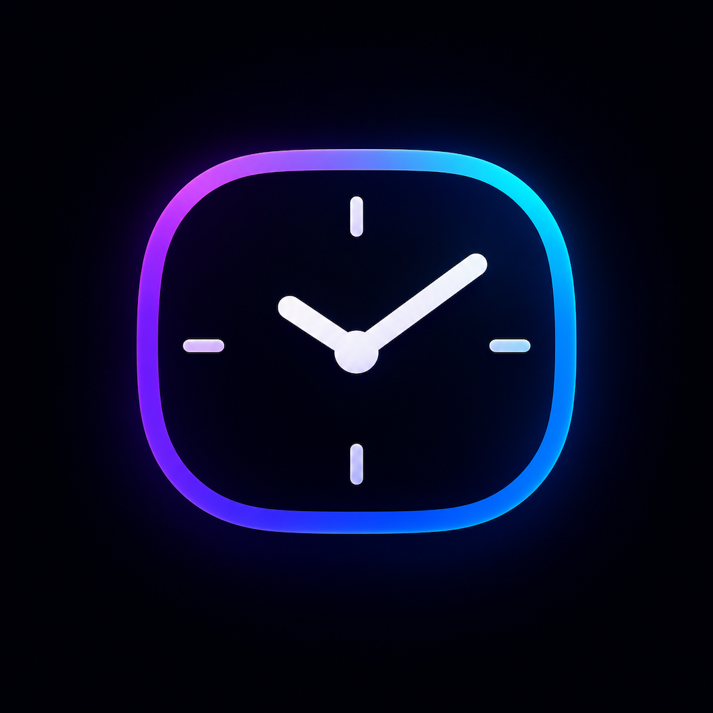
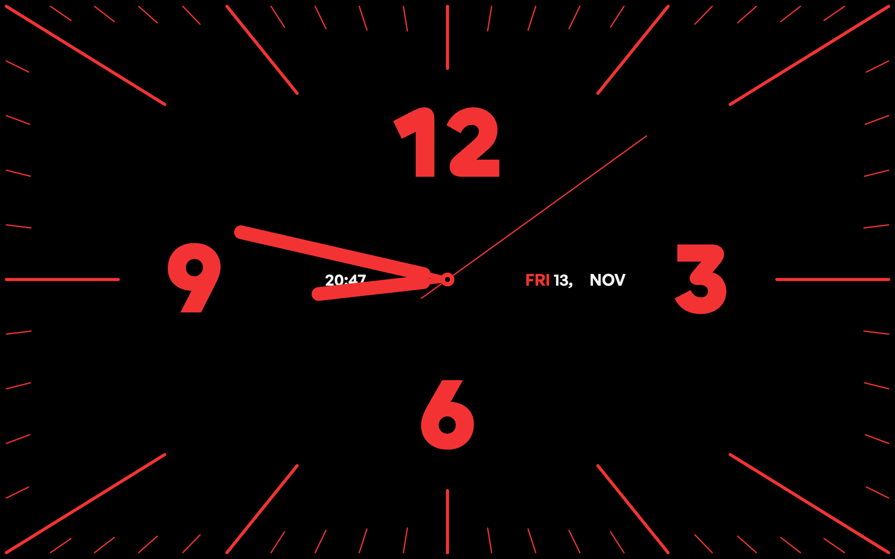

<div align="center">
  
  <h1>Clocked</h1>
  <p>A full-screen analog clock that runs as your screen saver on macOS and Windows.</p>
  <p>
    <a href="https://github.com/Reaper45/clocked/releases/latest">Download</a>
    ·
    <a href="#installation">Installation</a>
    ·
    <a href="#uninstallation">Uninstallation</a>
    ·
    <a href="#development">Development</a>
  </p>
  
</div>

## Features

- Bold analog clock with the digital time and date, sized to fill the screen
- Real OS screen saver: the system handles the idle timer, dismissing and the password prompt
- Covers every monitor on Windows
- Dark theme, built-in fonts, works offline

## Installation

Download the file for your OS from the [latest release](https://github.com/Reaper45/clocked/releases/latest).

### macOS (13 Ventura or later)

1. Download `Clocked-macOS.saver.zip` and unzip it.
2. The saver isn't notarized, so clear the download quarantine first:
   ```sh
   xattr -dr com.apple.quarantine ~/Downloads/Clocked.saver
   ```
3. Double-click `Clocked.saver` and choose to install it for this user.
4. Open **System Settings → Screen Saver** and pick **Clocked** (third-party savers are listed at the bottom).
5. To require your password when it stops, set **System Settings → Lock Screen → Require password after screen saver begins** to **Immediately**.

To update, install the new version over the old one, then log out and back in so macOS loads it.

### Windows (10 or later)

1. Download `Clocked.scr`.
2. Right-click it and choose **Install**. Windows may show a SmartScreen warning because the file isn't signed; choose **More info → Run anyway**.
3. In **Settings → Personalization → Lock screen → Screen saver**, pick **Clocked**, set the wait time and tick **On resume, display logon screen**.

Needs the WebView2 runtime, which is preinstalled on Windows 10 and 11. The small preview in the Screen Saver Settings dialog stays blank; use **Preview** to see it full screen.

## Uninstallation

### macOS

1. Open **System Settings → Screen Saver** and pick a different screen saver, so macOS isn't left using one that's gone.
2. Remove the saver, either way:
   - In Finder, choose **Go → Go to Folder…**, enter `~/Library/Screen Savers`, and move `Clocked.saver` to the Trash.
   - Or in Terminal:
     ```sh
     rm -rf ~/Library/Screen\ Savers/Clocked.saver
     ```
3. Log out and back in so macOS unloads it.

If you installed it from source, `pnpm saver:uninstall` does step 2 for you, including any temporary copies an install left behind.

### Windows

1. In **Settings → Personalization → Lock screen → Screen saver**, set the screen saver to **(None)** or another one, and click **OK**.
2. Delete `Clocked.scr` from where you saved it. Right-click **Install** uses the file in place, so that's usually your Downloads folder. If you copied it into `C:\Windows\System32`, delete it from there instead (Windows asks for administrator permission).

## Development

### Prerequisites

- [Node.js](https://nodejs.org/) 22+ and [pnpm](https://pnpm.io/)
- [Rust](https://rustup.rs/) and the [Tauri prerequisites](https://v2.tauri.app/start/prerequisites/) (Windows build and `tauri dev`)
- Xcode or the Xcode Command Line Tools (macOS saver)

### Setup

```sh
pnpm install
```

### Commands

| Command | What it does |
|---|---|
| `pnpm dev` | Runs the clock in the browser at http://localhost:1420 |
| `pnpm tauri dev` | Runs the Tauri app full screen; any input closes it |
| `pnpm saver` | Builds `saver/build/Clocked.saver` (macOS) |
| `pnpm saver:install` | Builds the macOS saver and installs it into `~/Library/Screen Savers` |
| `pnpm saver:uninstall` | Removes the macOS saver from `~/Library/Screen Savers` |
| `pnpm tauri build` | Builds the Windows app; rename the `.exe` in `src-tauri/target/release` to `.scr` |

### How it works

- `src/` is the clock: a React canvas that redraws every frame.
- **macOS**: `saver/` is a native screen saver (`ScreenSaverView`) that loads the built clock in a `WKWebView` from inside the bundle.
- **Windows**: the Tauri app is the screen saver. Windows runs it with `/s`, it opens a window on each monitor, and exits on any key, click or mouse move.

